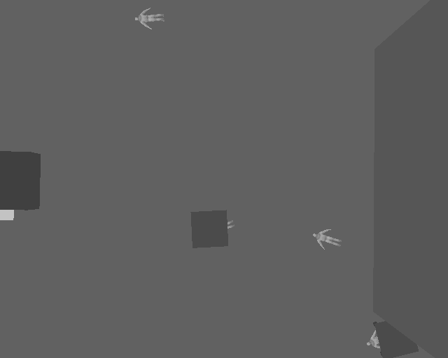
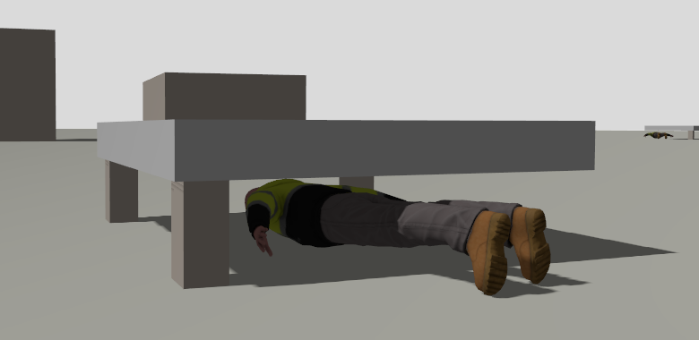
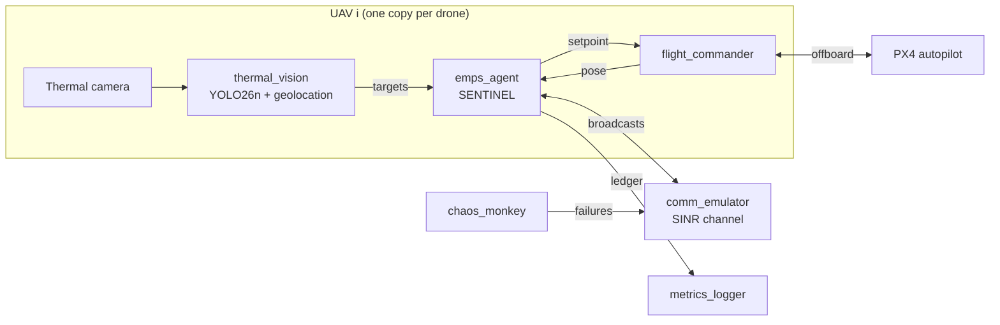

# Edge-AI Driven Elastic Mesh PSO for Low-Altitude UAV IoT Networks in Zero-Infrastructure Environments

**SENTINEL v2:** information-triggered delivery for timely victim reporting in infrastructure-free UAV search and rescue.

ICIUS 2026, submission UN006, under review. Paper: [`paper_icius_ios/main.pdf`](paper_icius_ios/main.pdf).


After an earthquake or a building collapse there is often no cellular network. A swarm of small
drones with thermal cameras can find survivors quickly, but **a sighting only helps once it reaches
the rescue team**, and the radio links between drones break behind buildings, through rubble and when
drones fail. SENTINEL is a fully decentralised swarm controller built around that problem. It
measures success by how many victims are **reported to the responders within 60 seconds** of
first being confirmed, not by how many are merely seen.

<table>
  <tr>
    <td width="50%"></td>
    <td width="50%"></td>
  </tr>
  <tr>
    <td><sub>Generated disaster area in Gazebo Harmonic: no-fly building shells, rubble and concrete slabs.</sub></td>
    <td><sub>What a UAV sees at 30 m: victims in the open, victims under slabs (only legs visible) and warm debris.</sub></td>
  </tr>
  <tr>
    <td></td>
    <td></td>
  </tr>
  <tr>
    <td><sub>Occlusion: torso hidden from above, legs exposed.</sub></td>
    <td><sub>YOLO26n (trained on real HIT-UAV images) running in the loop; it is less confident on rendered mannequins, a simulation-to-real gap.</sub></td>
  </tr>
</table>

---

## How it works

Every UAV runs the same agent, with no central coordinator and no infrastructure. SENTINEL treats the
network as an **elastic mesh that stretches and breaks during search and is re-formed only to deliver
a confirmed report**.

| Component | What it does |
|---|---|
| **Information-triggered delivery** | Each UAV searches freely in **Explore** mode. When a victim it confirmed has not reached the responder within a hold time `T_h`, it switches to **Deliver** and carries the report back into the responder's network. Copies held by other UAVs are delivered if the creator fails. |
| **Corroborative sensing** | A weak detection (confidence between 0.40 and 0.70) asks the nearest neighbour for a second view ±15 m across the line of sight. Views are fused so that a blocked angle cannot veto a clear one; naive-Bayes fusion lets weak, blocked views pull a clear detection down. |
| **EM-PSO with an outage-based Signal-Spring** | Elastic-Mesh PSO (constriction PSO) plans the waypoints throughout, over expected detections, tentative entries and a frontier goal. The Signal-Spring penalises predicted link outage, not distance, and acts only while a UAV delivers or relays. |
| **Link preservation** | While delivering, a UAV keeps its neighbours in the local minimum spanning tree of reliable links and scales its step so that those links stay reliable, allowing for stale positions and obstructions (Lemma 1 and Proposition 1 in the ICIUS paper; further results in the [extended results](docs/icius2026_extended_results.md)). It is a safety property; the reporting gains come from delivery and sensing. |
| **Channel model** | Links are modelled by SINR, not by a distance threshold: log-distance path loss, building and rubble obstructions, correlated shadowing, Rician/Rayleigh fading and colliding transmitters. |
| **World-frame ledger** | Geolocated sightings are merged with 5 m gating, replicated by gossip with acknowledgements, and backed by a CRDT search map. |



The algorithms live in **one ROS-independent Python library** (`sentinel_core`). The same code is
driven by a fast multi-agent simulator, used for the statistics, and by ROS 2 nodes that fly PX4
quadrotors in Gazebo, so both environments test identical decision logic.

---

## Results

<!-- generated by sentinel_ws/scripts/make_readme.py from paper_icius_ios/generated/numbers.tex,
     docs/icius2026_extended_results.md and the detector benchmark; do not edit by hand -->

The main results file is [`docs/icius2026_extended_results.md`](docs/icius2026_extended_results.md):
every table of the paper and the ones it omits, with confidence intervals and tests.

The evaluation spans about **17,000 simulated missions** with 30 seeds per configuration.
SENTINEL is compared with 9 baselines, each tuned with the same Optuna budget:

| | Baseline |
|---|---|
| B0 | PSO |
| B1 | first SENTINEL version (distance to the nearest neighbour) |
| B2 | communication-aware PSO (outage penalty) |
| B3 | λ₂ connectivity control (exact λ₂) |
| B4 | edge potentials |
| B5 | MAPPO |
| B6 | sweep search |
| B7 | hard wall (distance limit to the nearest neighbour) |
| B8 | relay chain from the responder |

The metric is the **share of victims reported to the responder within 60 s** of first confirmation.
Statistics are 95 % bootstrap confidence intervals and paired Wilcoxon tests with Holm correction.
Unless stated otherwise: 400 m area, N = 8 UAVs, urban rubble, Poisson crashes.

| Channel profile | SENTINEL | Best baseline | Outcome |
|---|---|---|---|
| open | 0.577 | 0.501 (B8) | significantly ahead of every baseline |
| suburban | 0.560 | 0.504 (B3) | significantly ahead of every baseline |
| urban rubble | 0.575 | 0.509 (B0) | significantly ahead of every baseline |
| severe | 0.433 | 0.381 (B0) | ahead, not significant against B0 |

- **Failures (urban rubble, six failure settings):** SENTINEL reports 7–18 %
  more victims than the best baseline in every setting (0.46–0.69),
  significantly except against B2 under Poisson crashes.
- **Swarm size, 400 m, N = 3–50:** SENTINEL has the highest mean at every size except one
  (N = 3, B2 0.23 vs. 0.20; not significant), and is significantly ahead of every baseline from
  N = 10 to 50.
- **Denser 200 m area:** a baseline (B0, B1, B3) has the highest mean at every
  swarm size, never significantly.
- **Detector model fitted to detector outputs** (rendered frames, no re-tuning; urban rubble, six failure
  settings): SENTINEL differs from the best baseline by −1.5 to +3.4 %, has the highest
  mean in 4 of 6 settings and differs significantly in none.
- **Overall:** SENTINEL has the highest mean in 19 of 26 channel, failure and swarm-size
  settings, and no baseline in its original form is significantly ahead of it in any of them.
- **Where the gains come from:** removing fusion (0.519) or delivery (0.523) lowers the
  urban share significantly from 0.575; a mesh kept connected at all times falls to
  0.03–0.13. Given SENTINEL's fusion rule, the best urban baseline (B2)
  rises from 0.480 to 0.549 and is no longer significantly behind; the other baselines
  still are. In a dense 50-UAV swarm on 200 m, baselines with fusion reach
  0.784–0.851 against SENTINEL's 0.809, and B4 + fusion is ahead
  (significant in the paper's Table 4, not after Holm correction over all nine baselines): there,
  fusion alone explains the gain.
- **Link safety:** preserved links failed within a step 74 times in 1,348,166 link-steps
  (5.5×10⁻⁵). On the same settings and seeds, disabling the projection raised violations from
  1 in 1,663 to 42 in 1,868 link-steps, a 37-fold difference
  (p < 10⁻⁴), with the on-time share unchanged.
- **Sensitivity:** varying λ₀ (0.3–4.8), β (0–4) or ε
  (0.01–0.2), or using a distance spring (R_max = 30–70 m),
  changes the share by at most 0.015, never significantly.
- **PX4/Gazebo:** 3 PX4 UAVs on 3 worlds of 100 m with one crash agree with
  the fast simulator within 0.06 on reported victims, packet delivery and connected time. With
  the fine-tuned YOLO26n in the loop on 10 worlds, SENTINEL reports 0.89 and B0 0.91
  (difference −0.02, 95 % CI −0.07 to +0.04, p = 0.48): no difference detected.
  Both checks fly B0 with its tuned values from before the baseline re-run, in PX4 and in the fast simulator.
- **Planning time:** 4–11 ms per agent for N = 3–50, against a
  1 s planning period (desktop CPU).

**Onboard detector** (thermal dataset HIT-UAV, identical training protocol, validation split):

| Model | Params | GFLOPs | mAP50 | mAP50-95 | TensorRT FP16 (desktop RTX 3060) |
|---|---|---|---|---|---|
| **YOLO26n** (deployed) | 2.53 M | 6.0 | 0.948 | 0.533 | 1.81 ms |
| YOLOv8n | 3.14 M | 8.7 | 0.947 | 0.520 | 1.73 ms |

On Gazebo-rendered thermal frames at 25–30 m (rendered frames only, not real footage),
the HIT-UAV model reaches 0.05 mAP50 on 5 unseen worlds, and 0.99 after
fine-tuning on 14 others.

---

## Repository layout

```text
SENTINEL/
├── sentinel_ws/
│   ├── src/
│   │   ├── sentinel_core/        # algorithm library (no ROS): channel, graph/LMST, link preservation,
│   │   │                         #   ledger + fusion, CRDT map, PSO, flanking, detector model, baselines, tests
│   │   ├── sentinel_sim/         # fast simulator, batch runner, Optuna tuning, MAPPO training, statistics
│   │   │   └── configs/          #   experiments/*.yaml, tuned values, trained MAPPO policy
│   │   ├── sentinel_ai/          # ROS 2 nodes: flight_commander, thermal_vision, emps_agent,
│   │   │                         #   comm_emulator, chaos_monkey, metrics_logger; YOLO weights
│   │   ├── sentinel_gazebo/      # procedural disaster worlds, x500_thermal drone, victims, launch_sitl.sh
│   │   └── sentinel_interfaces/  # ROS 2 messages
│   └── scripts/                  # one-command demo, experiment batches, benchmarks, make_readme.py
│       └── overnight/            #   revision experiments: B7/B8, sensitivity, detector, PX4 checks, re-runs
├── paper_icius_ios/              # submitted ICIUS 2026 paper (IOS Press template): main.pdf,
│                                 #   main_highlighted.pdf, generated numbers and tables, scripts/make_ios.py
├── docs/                         # extended results, analysis plan, run guide, changelog, figures
├── LICENSE
├── README.md
└── requirements.txt
```

---

## Getting started

**Tested on:**

| Component | Version |
|---|---|
| OS | Ubuntu 22.04 |
| ROS 2 | Humble |
| Gazebo | Harmonic (with `ros-humble-ros-gzharmonic`) |
| PX4-Autopilot | `main` (v1.18 dev), SITL built |
| PX4 message definitions | `px4_msgs` (`main`) |
| DDS bridge | Micro XRCE-DDS Agent |
| GPU | NVIDIA, optional (needed only for YOLO) |

### 1. Workspace

The scripts expect this layout:

```bash
mkdir -p ~/sentinel_ws/src && cd ~/sentinel_ws/src
git clone -b v2 https://github.com/KS-KARTHIK-05/SENTINEL.git
git clone https://github.com/PX4/px4_msgs.git
```

### 2. Python environment

NumPy must stay below 2, because the apt builds of OpenCV and `cv_bridge` need NumPy 1.x.

```bash
python3 -m venv --system-site-packages ~/sentinel_venv
source ~/sentinel_venv/bin/activate
pip install -r ~/sentinel_ws/src/SENTINEL/requirements.txt
```

### 3. Build

```bash
source /opt/ros/humble/setup.bash
cd ~/sentinel_ws && colcon build
source install/setup.bash
```

### 4. Run the full demo (one command)

```bash
ln -s ~/sentinel_ws/src/SENTINEL/sentinel_ws/scripts/sentinel_demo.sh ~/sentinel_ws/run_sentinel_demo.sh
~/sentinel_ws/run_sentinel_demo.sh --no-crash
```

This opens Gazebo with the disaster world and **6 PX4 drones**, starts the SENTINEL stack with
YOLO26n, and opens the camera and node-graph viewers. Press `Ctrl-C` to stop everything.

| Option | Meaning |
|---|---|
| `-n N` | number of drones (default 6; about 9 is the limit on a desktop CPU) |
| `-w WORLD` | `sentinel_g100_s0/1/2`, `sentinel_g200_s0`, or `sentinel_d25_s0` (the original 25 m scene) |
| `-p model` | parameterised detector model instead of YOLO (lighter; drones have no camera) |
| `-m METHOD` | fly a baseline instead, e.g. `B0_pso`, `B6_lawnmower` |
| `--no-crash` | no injected UAV failure (default: UAV 1 fails at t = 150 s) |
| `--headless` | no GUI windows |

### 5. Reproduce the numbers

```bash
# unit tests of the three Python packages
cd ~/sentinel_ws/src/SENTINEL/sentinel_ws/src
for p in sentinel_core sentinel_sim sentinel_ai; do (cd $p && python -m pytest -q test/); done

# Monte-Carlo check that the projection keeps the swarm connected (expects failures=0)
python ~/sentinel_ws/src/SENTINEL/sentinel_ws/scripts/verify_prop1.py 10000 0

# one experiment (deterministic per seed), then its tables and significance tests
cd ~/sentinel_ws/src/SENTINEL/sentinel_ws/src/sentinel_sim
python -m sentinel_sim.runner configs/experiments/e2_channel.yaml --out ~/sentinel_ws/results/e2_channel --jobs 8
python -m sentinel_sim.analyze ~/sentinel_ws/results/e2_channel
```

**ICIUS paper numbers.** Per-run results are stored outside the repository, in `~/sentinel_ws/results/`
(one folder per experiment, `summary.parquet` with one row per run). `make_ios.py` reads the experiment
folders (`e1_scalability`, `e2_channel`, `e3_failures`, `e7_ablation`, ...) and the revision folders
`overnight_2026-10-28/`, `e5_recheck_2026-10-29/`, `baseline_rerun_2026-10-29/` and `perception/` from
there. The experiment configs (`sentinel_sim/configs/experiments/`) and the scripts in
`sentinel_ws/scripts/overnight/` recreate them; the [run guide](docs/RUN_GUIDE.md) lists the commands.

```bash
cd ~/sentinel_ws/src/SENTINEL
python paper_icius_ios/scripts/make_ios.py     # paper_icius_ios/generated/ and docs/icius2026_extended_results.md
python sentinel_ws/scripts/make_readme.py      # the Results section of this README
```

More detail is in [`docs/RUN_GUIDE.md`](docs/RUN_GUIDE.md).

---

## What changed from v1

The first version of this project was rejected by IEEE IoT-J. An audit during the rework found that
the v1 code did not implement what the v1 paper described:

- it had no PSO, and its fitness function was never called;
- telemetry was always (0, 0);
- the ledger stored camera-frame offsets;
- the swarm size was fixed at three.

None of the v1 headline numbers could be reproduced, so **v2 drops all of them**. v2 is a rebuild:

- every component is implemented and tested;
- reviewer requests are addressed in simulation; hardware flights and embedded (Jetson) measurements remain future work;
- every reported number traces to a script.

During the ICIUS revision, a fusion-rule inconsistency was found in six baselines; they were re-tuned,
and every affected row was re-run on the released code.

The history is in [`docs/CHANGELOG.md`](docs/CHANGELOG.md), and the plan of the revision experiments,
fixed before they ran, is in [`docs/analysis_plan_icius2026.md`](docs/analysis_plan_icius2026.md).

## Limitations

- All results are simulated (fast simulator and PX4/Gazebo software-in-the-loop), with channel parameters from published ranges; there are no hardware flights.
- Detector accuracy at 25–30 m is measured on rendered frames only, and the simulation loop uses a detector model that is hand-set or fitted to detector outputs on rendered frames.
- With the fitted detector model, SENTINEL has the highest mean in 4 of 6 urban failure settings and differs from the best baseline by −1.5 to +3.4 %, never significantly.
- On the denser 200 m area, a baseline has the highest mean at every swarm size (never significantly).
- Victims within the 5 m association gate can merge.
- B5 (MAPPO) was trained with one reward design.
- No embedded (Jetson) latency was measured; detector timings are on a desktop GPU.

## Authors

Karthik KS · Nicholas Christo T · Balaji Ganesh Rajagopal (corresponding author)

ICIUS 2026 submission UN006, under review ([`paper_icius_ios/main.pdf`](paper_icius_ios/main.pdf)); citation details on publication.

## License

The code in this repository is released under the [MIT License](LICENSE),
© 2026 Karthik KS and Nicholas Christo T.

Third-party components keep their own licenses:

| Component | Source | License |
|---|---|---|
| YOLO weights in `sentinel_ws/src/sentinel_ai/models/` (`yolo26n_thermal_best.pt`, `yolo26n_thermal.onnx`, `yolov8n_v1_best.pt`) | trained with [Ultralytics](https://github.com/ultralytics/ultralytics) | AGPL-3.0 |
| Ultralytics (runtime dependency of `detector.py` and `bench_detector.py`; not included) | Ultralytics | AGPL-3.0 |
| Rescue Randy mesh and material in `sentinel_gazebo/models/rescue_randy_thermal/` (heat signature and plugin names modified) | Ian Chen, Cole Biesemeyer (Open Robotics), Gazebo Fuel | CC BY 4.0 |
| x500 airframe (included from PX4 at run time; not copied here) | PX4-Autopilot | BSD-3-Clause |
| `IOS-Book-Article.cls` and the IOS Press template files in `paper_icius_ios/` | VTeX for IOS Press | LPPL |
| `paper_icius_ios/vancouver.bst` | Folkert van der Beek | LPPL 1.3 or later |
