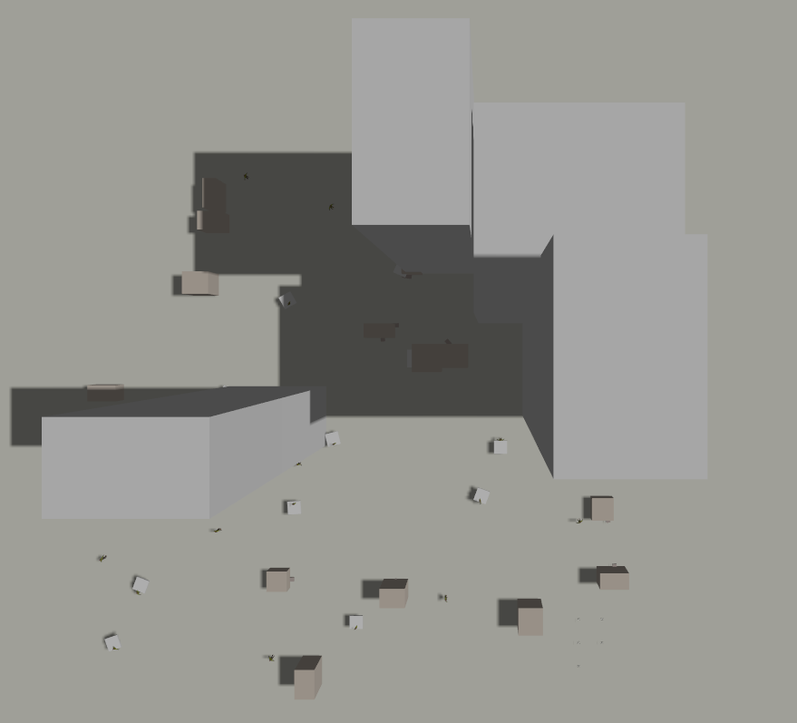
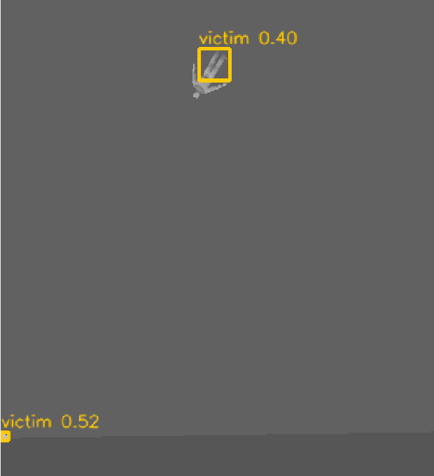
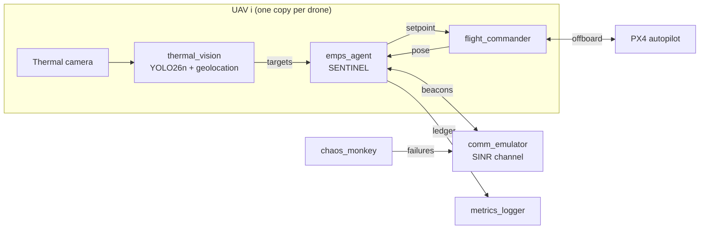

# SENTINEL v2

**Information-triggered delivery for timely victim reporting in infrastructure-free UAV search and rescue**

Paper: Edge-AI Driven Elastic Mesh PSO for Low-Altitude UAV IoT Networks in Zero-Infrastructure Environments, ICIUS 2026 (submission UN006).


After an earthquake or a building collapse there is often no cellular network. A swarm of small
drones with thermal cameras can find survivors quickly, but **a sighting only helps once it reaches
the rescue team**, and the radio links between drones break behind buildings, through rubble and when
drones fail. SENTINEL is a fully decentralised swarm controller built around that problem. It
measures success by how many victims are **reported to the responders within 60 seconds** of
first being confirmed, not by how many are merely seen.

<table>
  <tr>
    <td width="50%"></td>
    <td width="50%"></td>
  </tr>
  <tr>
    <td><sub>Generated disaster area in Gazebo Harmonic: no-fly building shells, rubble and concrete slabs.</sub></td>
    <td><sub>What a UAV sees at 30 m: victims in the open, victims under slabs (only legs visible) and warm debris.</sub></td>
  </tr>
  <tr>
    <td></td>
    <td></td>
  </tr>
  <tr>
    <td><sub>Occlusion: torso hidden from above, legs exposed.</sub></td>
    <td><sub>YOLO26n running on board in the loop (low confidence on rendered mannequins: a sim-to-real gap).</sub></td>
  </tr>
</table>

---

## How it works

Every UAV runs the same agent, with no central coordinator and no infrastructure.

| Component | What it does |
|---|---|
| **Information-triggered delivery** | Each UAV searches freely in **Explore** mode. When it holds a confirmed victim that the responder has not yet received, it switches to **Deliver** and carries the report back into the responder's network. A single hold time `T_hold` sets the trade-off between discovery and delivery. |
| **Corroborative multi-view fusion** | A tentative detection asks a neighbour for a second look from a side angle (synthetic-aperture flanking, ±15 m). Views are fused so that a blocked view cannot veto a clear one. Naive Bayesian fusion penalises occluded views. |
| **Link-preservation safety layer** | During delivery, each UAV keeps a local minimum-spanning-tree neighbour set and projects its step into a ball that keeps those links within reliable range, allowing for stale positions and obstructions. The guarantee is proved in the paper (Lemmas 1–2, Propositions 1–3, Corollary 1). |
| **Channel-aware planning** | Links are modelled by SINR, not by a distance threshold: log-distance path loss, building and rubble obstructions, correlated shadowing, Rician/Rayleigh fading and interference. Waypoints come from constriction PSO over coverage, detections and a frontier goal. |
| **World-frame ledger** | Geolocated sightings are merged with 5 m gating, replicated by gossip with acknowledgements, and backed by a CRDT search map. Ten victims cannot produce fifteen entries. |



The algorithms live in **one ROS-independent Python library** (`sentinel_core`). The same code is
driven by a fast multi-agent simulator, used for the statistics, and by ROS 2 nodes that fly PX4
quadrotors in Gazebo, so both environments test identical decision logic.

---

## Results

The evaluation spans about **13,000 simulated missions**, with 30 seeds per configuration.
SENTINEL is compared with 7 baselines, each tuned with the same Optuna budget:

| | Baseline |
|---|---|
| B0 | PSO |
| B1 | earlier SENTINEL design |
| B2 | communication-aware PSO |
| B3 | λ₂-gradient connectivity control (oracle λ₂) |
| B4 | potential fields |
| B5 | MAPPO |
| B6 | lawnmower |

Statistics are 95 % bootstrap CIs and paired Wilcoxon tests with Holm correction.
The metric is the **share of victims reported to the responder within 60 s**.

| Scenario | SENTINEL | Best baseline | Outcome |
|---|---|---|---|
| Channel: open / suburban / urban rubble | 0.577 / 0.560 / 0.575 | 0.501 / 0.456 / 0.475 | significantly better than all 7 |
| Channel: severe | 0.433 | 0.377 | ahead, not significant vs. the best |
| Failures, urban, 6 failure models | 0.46–0.69 | 0.36–0.56 | significantly better than all 7 in every model |
| Scalability, 400 m, N = 3–50 | 0.20–0.79 | 0.15–0.73 | significantly better than all 7 at every N |
| Scalability, 200 m | 0.48–0.81 | 0.46–0.78 | better at N = 50; tied with MAPPO at N = 10–20 |
| Moving obstacles | 0.58 | ≤ 0.51 | significantly better than all 7 |
| Dense swarm (200 m, N = 50) | 0.809 | 0.720 | significantly better; naive fusion gives 0.656. With SENTINEL's fusion added, baselines reach 0.815–0.865 (B4 + fusion significantly better): here fusion alone explains the gain |
| Delivery trigger, N = 8, urban / severe | 0.599 / 0.501 (`T_hold` = 15 s) | 0.523 / 0.419 (never deliver) | +15 % / +20 %, significant |
| Urban, baselines given SENTINEL's fusion rule (N = 4 / 8) | 0.313 / 0.575 | 0.228 / 0.507 | still significantly better than all 7 |

- **Link safety:** 65 violations in 1,317,947 preserved link-steps (4.9×10⁻⁵). On the same seeds, disabling the projection raises violations 37-fold (1 vs 42; p < 10⁻⁴). A Monte-Carlo check of Proposition 1 over 10⁴ trials found 0 failures.
- **Scalability:** planning takes 4–11 ms per agent for N = 3–50, against a 1 s planning period.
- **Ablation:** fusion and the delivery trigger have significant effects; with fusion, flank and delivery all removed SENTINEL is still ahead of every baseline given fusion; the remaining differences (tuned exploration aids, heartbeat re-attachment) are not claimed as contributions. The connectivity layer does not change the on-time share; it is reported as a safety property.
- **Gazebo/PX4 cross-check:** the software-in-the-loop runs agree with the fast simulator within 0.07 on reporting and 0.04 on packet delivery.

**Onboard detector** (identical training protocol, thermal dataset HIT-UAV):

| Model | Params | GFLOPs | mAP50 | mAP50-95 | TensorRT FP16 (RTX 3060) |
|---|---|---|---|---|---|
| **YOLO26n** (deployed) | 2.53 M | 6.0 | 0.948 | 0.533 | 1.81 ms |
| YOLOv8n | 3.14 M | 8.7 | 0.947 | 0.520 | 1.73 ms |

Every number above is generated by script from the stored runs. The full tables, confidence
intervals and tests are in [`docs/RESULTS.md`](docs/RESULTS.md).

---

## Repository layout

```text
SENTINEL/
├── sentinel_ws/
│   ├── src/
│   │   ├── sentinel_core/        # algorithm library (no ROS): channel, graph/LMST, safety projection,
│   │   │                         #   ledger + fusion, CRDT map, PSO, SA, detector model, baselines, 396 tests
│   │   ├── sentinel_sim/         # fast simulator, batch runner, Optuna tuning, MAPPO training, statistics
│   │   │   └── configs/          #   experiments/*.yaml, tuned.yaml, trained MAPPO policy
│   │   ├── sentinel_ai/          # ROS 2 nodes: flight_commander, thermal_vision, emps_agent,
│   │   │                         #   comm_emulator, chaos_monkey, metrics_logger; YOLO26n weights
│   │   ├── sentinel_gazebo/      # procedural disaster worlds, x500_thermal drone, victims, launch_sitl.sh
│   │   └── sentinel_interfaces/  # ROS 2 messages
│   └── scripts/                  # one-command demo, experiment batches, make_results.py, benchmarks
├── paper/                        # LaTeX manuscript (main.pdf), generated tables and figures
└── docs/                         # rework plan, progress log, results, run and screenshot guides
```

---

## Getting started

**Tested on:**

| Component | Version |
|---|---|
| OS | Ubuntu 22.04 |
| ROS 2 | Humble |
| Gazebo | Harmonic (with `ros-humble-ros-gzharmonic`) |
| PX4-Autopilot | `main` (v1.18 dev), SITL built |
| PX4 message definitions | `px4_msgs` (`main`) |
| DDS bridge | Micro XRCE-DDS Agent |
| GPU | NVIDIA, optional (needed only for YOLO) |

### 1. Workspace

The scripts expect this layout:

```bash
mkdir -p ~/sentinel_ws/src && cd ~/sentinel_ws/src
git clone -b v2 https://github.com/KS-KARTHIK-05/SENTINEL.git
git clone https://github.com/PX4/px4_msgs.git
```

### 2. Python environment

NumPy must stay below 2, because the apt builds of OpenCV and `cv_bridge` need NumPy 1.x.

```bash
python3 -m venv --system-site-packages ~/sentinel_venv
source ~/sentinel_venv/bin/activate
pip install -r ~/sentinel_ws/src/SENTINEL/requirements.txt
```

### 3. Build

```bash
source /opt/ros/humble/setup.bash
cd ~/sentinel_ws && colcon build
source install/setup.bash
```

### 4. Run the full demo (one command)

```bash
ln -s ~/sentinel_ws/src/SENTINEL/sentinel_ws/scripts/sentinel_demo.sh ~/sentinel_ws/run_sentinel_demo.sh
~/sentinel_ws/run_sentinel_demo.sh --no-crash
```

This opens Gazebo with the disaster world and **6 PX4 drones**, starts the SENTINEL stack with
YOLO26n, and opens the camera and node-graph viewers. Press `Ctrl-C` to stop everything.

| Option | Meaning |
|---|---|
| `-n N` | number of drones (default 6; about 9 is the limit on a desktop CPU) |
| `-w WORLD` | `sentinel_g100_s0/1/2`, `sentinel_g200_s0`, or `sentinel_d25_s0` (the original 25 m scene) |
| `-p model` | parameterised detector model instead of YOLO (lighter; drones have no camera) |
| `-m METHOD` | fly a baseline instead, e.g. `B0_pso`, `B6_lawnmower` |
| `--no-crash` | no injected UAV failure (default: UAV 1 fails at t = 150 s) |
| `--headless` | no GUI windows |

### 5. Reproduce the numbers

```bash
# unit tests (396)
cd ~/sentinel_ws/src/SENTINEL/sentinel_ws/src/sentinel_core && python -m pytest -q test/

# Monte-Carlo check of Proposition 1 (expects failures=0)
python ~/sentinel_ws/src/SENTINEL/sentinel_ws/scripts/verify_prop1.py 10000 0

# one experiment (deterministic per seed), then its tables and significance tests
cd ~/sentinel_ws/src/SENTINEL/sentinel_ws/src/sentinel_sim
python -m sentinel_sim.runner configs/experiments/e2_channel.yaml --out ~/sentinel_ws/results/e2_channel --jobs 8
python -m sentinel_sim.analyze ~/sentinel_ws/results/e2_channel

# every paper table and figure from the stored results
python ~/sentinel_ws/src/SENTINEL/sentinel_ws/scripts/make_results.py \
    --results ~/sentinel_ws/results --docs ~/sentinel_ws/docs --paper ~/sentinel_ws/src/SENTINEL/paper
```

More detail is in [`docs/RUN_GUIDE.md`](docs/RUN_GUIDE.md).

---

## What changed from v1

The first version of this project was rejected by IEEE IoT-J (IoT-66280-2026). An audit during the
rework found that the v1 code did not implement what the v1 paper described:

- it had no PSO, and its fitness function was never called;
- telemetry was always (0, 0);
- the ledger stored camera-frame offsets;
- the swarm size was fixed at three.

None of the v1 headline numbers (network retention 66 → 100 %, discovery 60–90 %, 1.2 ms latency)
could be reproduced, so **v2 drops all of them**. v2 is a rebuild:

- every component is implemented and tested;
- every reviewer comment is addressed;
- every reported number traces to a script.

The full log of the rework is in [`docs/PROGRESS.md`](docs/PROGRESS.md), and the tables the
6-page ICIUS paper omits are in [`docs/icius2026_extended_results.md`](docs/icius2026_extended_results.md).

## Limitations

- All evaluation is in simulation: a fast simulator and PX4/Gazebo software-in-the-loop. There are no hardware flights.
- Channel parameters come from the literature, not from our own radio measurements.
- Detection accuracy is measured on real thermal images (HIT-UAV). In Gazebo, YOLO26n is less confident on rendered mannequins and also boxes some rubble edges, so Gazebo frames only illustrate the pipeline.
- In small dense swarms (N = 10–20 on 200 m), MAPPO comes close to SENTINEL.

## Authors

Karthik K S · Nicholas Christo T · Balaji Ganesh Rajagopal

The manuscript is in preparation (`paper/main.pdf`). Citation details will be added on publication.

## License

The code in this repository is released under the [MIT License](LICENSE),
© 2026 Karthik KS and Nicholas Christo T.

Third-party components keep their own licenses:

| Component | Source | License |
|---|---|---|
| YOLO weights in `sentinel_ws/src/sentinel_ai/models/` (`yolo26n_thermal_best.pt`, `yolo26n_thermal.onnx`, `yolov8n_v1_best.pt`) | trained with [Ultralytics](https://github.com/ultralytics/ultralytics) | AGPL-3.0 |
| Ultralytics (runtime dependency of `detector.py` and `bench_detector.py`; not included) | Ultralytics | AGPL-3.0 |
| Rescue Randy mesh and material in `sentinel_gazebo/models/rescue_randy_thermal/` (heat signature and plugin names modified) | Ian Chen, Cole Biesemeyer (Open Robotics), Gazebo Fuel | CC BY 4.0 |
| x500 airframe (included from PX4 at run time; not copied here) | PX4-Autopilot | BSD-3-Clause |
| `IOS-Book-Article.cls` and the IOS Press template files in `paper_icius_ios/` | VTeX for IOS Press | LPPL |
| `paper_icius_ios/vancouver.bst` | Folkert van der Beek | LPPL 1.3 or later |
